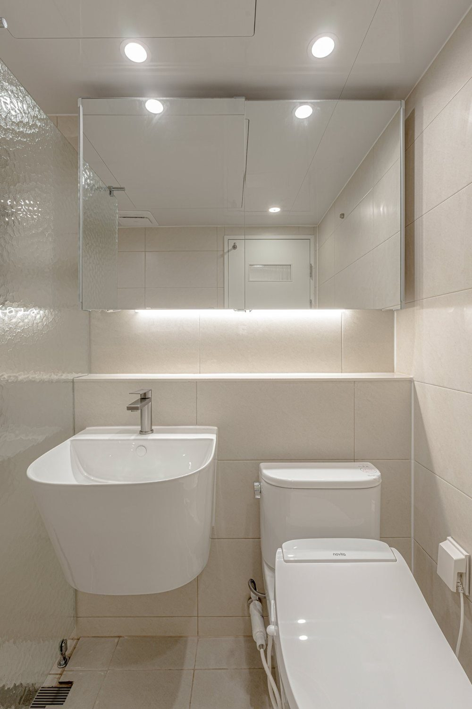

욕실은 집에서 가장 작은 공간이지만, 공사 공정은 가장 촘촘한 곳 중 하나입니다. 물을 쓰는 공간이라 **방수와 배수**가 제대로 되어야 하고, 한 공정이 끝나야 다음 공정으로 넘어갈 수 있기 때문입니다.

이 글에서는 욕실 리모델링이 어떤 순서로 진행되는지, 기간은 어느 정도 잡으면 되는지, 공사 전에 미리 정해 두면 좋은 것들을 정리했습니다.

## 욕실 공사는 이런 순서로 진행됩니다

| 순서 | 공정 | 하는 일 |
|---|---|---|
| 1 | 철거 | 기존 타일·도기·천장재·욕조 등을 걷어냅니다 |
| 2 | 설비 | 급수·배수 배관 위치를 정리하거나 옮깁니다 |
| 3 | 방수 | 바닥과 벽 하부에 방수층을 만들고 굳힙니다 |
| 4 | 타일 | 바닥 기울기(구배)를 잡고 벽·바닥 타일을 붙입니다 |
| 5 | 천장·조명 | 천장재, 환풍기, 조명을 설치합니다 |
| 6 | 도기·수전 | 세면대, 변기, 수전, 수납장, 액세서리를 설치합니다 |
| 7 | 마감 | 줄눈, 실리콘, 청소로 마무리합니다 |

현장 상태에 따라 순서가 조금 바뀌거나 공정이 합쳐지기도 하지만, 큰 흐름은 같습니다.

## 가장 중요한 공정, 방수

욕실에서 가장 중요한 공정을 하나만 꼽으라면 방수입니다. 타일을 붙이고 나면 방수층은 눈에 보이지 않기 때문에, **타일 전에 제대로 해 두는 것**이 무엇보다 중요합니다.

방수를 한 뒤에는 방수층이 충분히 굳을 시간이 필요합니다. 현장에 따라 물을 받아 두고 새는 곳이 없는지 확인하는 과정을 거치기도 합니다. 이 시간을 줄이면 일정은 빨라지지만, 나중에 아래층 누수 같은 큰 문제로 돌아올 수 있습니다.

*도기와 수납장은 타일과 천장 공사가 끝난 뒤 설치합니다*

## 기간은 어느 정도 잡아야 할까요

아파트 욕실 한 곳 기준으로 **짧게는 4~5일, 길게는 일주일 이상**을 잡는 것이 일반적입니다. 기간에 영향을 주는 요인은 다음과 같습니다.

- **덧방인지 전체 철거인지**: 전체 철거는 철거와 방수 공정이 추가되어 기간이 늘어납니다.
- **배관 위치 변경**: 세면대나 변기 위치를 옮기면 설비 공정이 길어집니다.
- **욕조 철거 여부**: 욕조를 없애고 샤워 공간으로 바꾸면 바닥 정리와 방수 범위가 넓어집니다.
- **자재 준비**: 원하는 타일이나 도기가 주문 제작이거나 재고가 없으면 일정이 밀릴 수 있습니다.

## 공사 전에 미리 정해 두면 좋은 것

공사가 시작되면 결정할 일이 연달아 생깁니다. 아래 내용을 미리 정해 두면 공사가 훨씬 수월합니다.

1. **욕조를 유지할지, 샤워 공간으로 바꿀지**
2. **샤워부스(문)로 할지, 고정 파티션(유리벽)으로 할지**
3. **타일 크기와 색상, 줄눈 색**
4. **수납장 크기와 위치** (거울장 일체형인지, 하부장도 둘지)
5. **환풍기·조명 종류** (간접조명, 비데용 콘센트 위치 등)

> 아파트라면 철거 소음 때문에 관리사무소에 공사 일정을 미리 알리고, 필요한 경우 이웃 동의서를 받아야 합니다. 단지마다 규정이 다르니 공사 전에 꼭 확인해 주세요.

## 정리하며

욕실 공사는 순서를 건너뛸 수 없는 공사입니다. 일정이 조금 길어 보여도, 방수처럼 눈에 보이지 않는 공정을 제대로 거치는 것이 오래 쓰는 욕실을 만드는 방법입니다.

라인 인테리어는 현장을 직접 확인한 뒤, 덧방과 전체 철거 중 어떤 방식이 맞는지부터 함께 살펴봅니다. 욕실 공사를 고민하고 계신다면 편하게 문의해 주세요.
